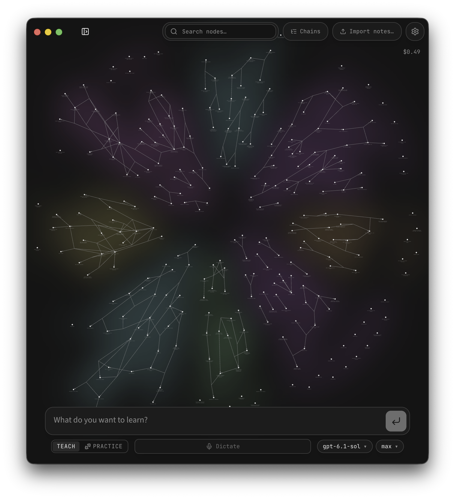

# ThinkFlow

ThinkFlow is a learning assistant for adaptive teaching, practice, and a persistent knowledge graph. Its home screen offers editable Quick Start topics for AI and data science.

[Architecture](docs/THINKFLOW_ARCHITECTURE.md) · [Four-minute demo](docs/THINKFLOW_DEMO.md) · [Viva](docs/THINKFLOW_VIVA.md) · [Troubleshooting](docs/THINKFLOW_TROUBLESHOOTING.md) · [ThinkFlow changelog](CHANGELOG_THINKFLOW.md)

[Documentation index](docs/README.md)

## How it works

1. **Measure.** Before teaching, the agent finds where your understanding ends on each part the lesson depends on. Your answers, confidence, and thinking show it where to start.
2. **Plan.** It works out a dependency map from that starting point to your goal. You can see the plan, and the lesson adapts when your understanding turns out different.
3. **Teach.** Each step builds on something you already understand. You predict, get an explanation, and check your understanding. Confusions are repaired before anything is built on them. The aim is for the goal to feel obviously true, not merely familiar.
4. **Practice.** Separate sessions pose varied problems that require the right knowledge to come to mind without being named first. Problems and hints adapt to your reasoning.

**Think out loud.** The thinking fields let you explain your reasoning, uncertainties, and reactions in your own words. This is how the agent gets a detailed picture rather than just a record of right and wrong answers. You can type or use dictation.

**Bring your files.** In the desktop app, attach PDFs, photos, or any other file with the paperclip, or drag them in. The file stays where it is: the message carries its path, and the agent reads it from there.

The agent can also research questions in the background, create visual explanations, show your own images in the lesson and mark them up with arrows and labels, and build interactive demonstrations.

## Knowledge that carries forward

What you are taught accumulates as propositions and reasoning chains: individual claims and the premises that lead to them. The graph shows this structure, with links back to the source sessions. You can also import notes.

Future teaching sessions can read the graph instead of starting from scratch. Practice sessions can draw their material from it. It stores the ideas and their connections, not ratings of your ability.



## Run locally

Use Node 26, as upstream CI does. From PowerShell:

```powershell
Set-Location 'C:\Users\samal\Desktop\project'
.\node_modules\.bin\next.cmd dev -H localhost
```

Open http://localhost:3000. Configure a model connection and the Strong, Cheap, and Vision slots in Settings before sending a lesson. See [ThinkFlow releases](https://github.com/Sur-yam/ThinkFlow/releases) for any published builds.

## Your keys, your data

- **Your keys and models.** No ThinkFlow subscription or markup. Billing depends on your provider, CLI configuration, subscription, or local setup. The live cost meter estimates known API costs, not subscription, CLI, or custom-endpoint charges.
- **Local storage.** Your chats, graph, settings, and API keys live on your machine. Learning records are plain files you can inspect.
- **External services.** Models run through your configured providers. Model requests send the context needed for the task; web research and dictation also contact external services. Local storage does not mean offline processing.
- **Inspectable behavior.** System prompts are visible and editable